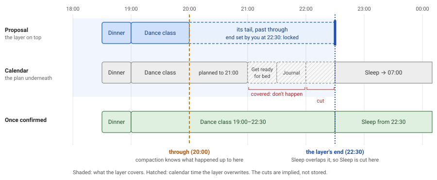

# Calendar edits vs. the open compaction proposal: the layer model

Status: redesign of 2026-11-16 around the user's layering idea. It replaces the earlier "soft made-room edits" and "split at `through`" designs. Built: server steps 1 and 2 (server PRs 341 and 342), and the client here.

## The model

The calendar is the underlying plan. The proposal is a **layer** drawn on top of it.

- **There is one layer.** It holds Claude's decisions and your edits together. Every event in it overwrites what is under it in the same way, whoever set its edges.
- **`through`** is how far compaction knows what happened: the notes are compacted up to it. Only a compaction round or the user's "extend" moves it.
- **A layer event** is one that starts before `through`. Everything that starts at or after `through` is a calendar event.
- **The layer's end** is separate from `through`. It is the end of the layer's last event, or `through` if that event ends earlier. So the layer reaches past `through` by at most the tail of one event: the one going on at `through`.
- **The layer overwrites what is under it.** A calendar event that the layer runs into is cut where the layer stops. One the layer runs right over is covered and doesn't happen. These cuts are *implied*: they are worked out from the layer each time it is looked at, and never stored as edits.

Because implied cuts aren't stored, nothing about them can lock. When the layer changes, they move with it.

The diagram is the dance class and sleep example, taking `through` as 20:00 for illustration. The class is the layer's last event, and the user set its end to 22:30, so the layer's end is 22:30 while `through` stays at 20:00. Under the layer, *Get ready for bed* and *Journal* are covered. Sleep is the calendar event overlapping the layer's end, so it is cut to start there.

## Who edits what

| | In the layer (starts before `through`) | On the calendar (starts at or after `through`) |
|---|---|---|
| **You** | Any edge, including the last event's end past `through`. The edge you set is locked. | Ordinary calendar edits. They are plan, and a later round may rework them. |
| **Claude** | Any edge up to `through`, never later. | Nothing. Compaction consolidates the past and doesn't adjust what is still to come. A reschedule you ask for in chat uses the calendar tools. |

One gesture has one deliberate change and goes one way, by where the event starts after the edit. Moving an event out from under the layer (dragging a missed gym session to later today) makes it a calendar edit and clears whatever the layer said about it.

A calendar edit can't land under the layer's last event. The app says that event runs until then, and to end it earlier first.

## What this replaces

- **Soft made-room edits** (`made_room_for`, the "Made room for…" label, Claude replacing them): gone. The app no longer records the neighbours it trimmed. They are implied by the layer, so Claude reworks them just by changing the layer.
- **The edge-by-edge split** of one gesture into a proposal write and a calendar write: gone. An event is wholly a layer event or wholly a calendar event.
- **"Claude may restore a cancel":** a covered event isn't cancelled. If a note shows it happened, Claude gives it a time in the layer.

The follow-through question at drag time stays. Covering an event is cancelling it, as the user sees it, so the app asks as it does for a cancel (see below).

Still as agreed: a drag locks only the edge you moved, there is no Pin, and Claude never pushes anything later than `through`.

## What went wrong, and how it plays out now

Late one evening the user dragged a *Dance class* to end at 22:30 (planned 19:00–21:00). The client made room, and recorded all four changes as locked user edits in the open proposal: the class's new times, Sleep's start at 22:30, and cancels of *Get ready for bed* and *Journal*. Claude is told never to fight user edits, so it couldn't place the ride home and what came after it, which the notes show going on until about 00:00. Several notes landed nowhere.

**Under the layer model:**
- The drag records one thing: the class ends at 22:30. That edge is locked.
- If `through` was still in the evening, the layer's end becomes 22:30 while `through` stays put. *Get ready for bed* and *Journal* are covered. Sleep, the calendar event overlapping the layer's end, is cut to start at 22:30. None of that is stored.
- At the next round Claude adds the ride home and what followed, up to 00:00. Sleep's cut moves to 00:00 by itself, with no decision about Sleep.
- If a note showed the journalling happened at 23:20, Claude would place *Journal* there.

It plays out the same if the window already covered the night when the drag was made.

## The sleep-in example

Last compacted 7:00. Now 9:30. A note says the user woke at 9:00. The calendar has Sleep ending 7:00, a string of morning events from 7:00 to 9:00, and Work 9:00–10:00.

- Claude moves Sleep's end to 9:00, from the wake note. That is its only decision about the morning.
- The morning events under Sleep are covered. Today Claude has to cancel or move each one, and in practice the user ends up cancelling each by hand.
- If the notes say the user got up and got ready from 9:00, Claude records that up to 9:30. Work, which crosses `through`, is cut to start at 9:30. Its end stays 10:00, so the layer's end is 10:00 while `through` is 9:30.
- If the notes say nothing after 9:00, Work stands as planned from 9:00.
- Claude pushes nothing later. Rescheduling the rest of the day is the user's, on the calendar: dragging the covered gym session to 10:30 is a calendar edit.

## Covered events and follow-through

For follow-through, a covered event is treated as a cancelled one.

- **When your drag covers events,** the app asks about follow-through there and then, with the dialog it shows today when a drag cancels events. It asks only about the events that dialog asks about now.
- **The answers are stored on the proposal,** beside the class's new end. They say only whether each covered event counts. They don't cancel it and don't lock anything.
- **If the layer changes and an event is no longer covered,** its answer is dropped.
- **An event that Claude's decision covers** (the morning under a sleep-in) has no drag to ask at. It gets the default a cancel by Claude has today: it counts, unless Claude cancels it itself and says it doesn't. You can flip it in review, as you can a cancelled event.

## Abandoning

Abandoning throws away the whole layer: Claude's decisions, your edits to it, any follow-through answers, and with them every implied cut and cover. As today, the notes stay uncompacted and Claude proposes again on its next run.

Calendar edits you made by hand while the proposal was open are not part of the layer, so they stay. The "Abandon it?" dialog lists the ones that were made around the layer:

- **Edits to an event the layer cut or covered**, such as the gym session you dragged out from under a sleep-in. They stay as you left them.
- **Edits in time the layer had freed.** This only happens in one place: the layer ended the event that crosses `through` early, and you put something in what was left of it. Once the layer is gone, that event has its planned end back and overlaps your edit. Abandon leaves the overlap as it is, and the dialog shows it: "Work (to 12:00) will overlap Call (11:00)". Sorting it out afterwards is an ordinary calendar edit.

## Notes about later events

A note about an event that starts at or after `through` ("skipping the gym tonight") changes nothing. Claude doesn't cancel or move the gym, in the layer or on the calendar, whether or not someone is there to ask. If you want it off the calendar, you cancel it there.

Not in this design: getting that note to the round that later covers the gym. Without it, that round may record the gym as having happened as planned. This is a separate feature, set aside for later.

## What changes on the server

**Proposal model**
- A new derived field for the layer's end (say `layer_end`) beside `through`, on `get_proposal`, `prepare_compaction` and the status summary.
- `events` ends with the layer's last event and whatever it cuts or covers. Planned events further on are no longer listed; the client draws those from the calendar.
- Each implied event says what did it: `cut_by` or `covered_by`, naming the layer event. So the shipped app keeps reading them right, a covered event keeps the `cancelled` status and a cut one `adjusted`; a split's later pieces are `new`, keyed `<event id>~N`. Implied events have no `decided_by`.
- A covered event carries whether it counts against follow-through and whom it counts against, as a cancelled event does. The user's answer is a new kind of user edit that says only whether the event counts. `amend_proposal` takes it alongside the edit that covers the event. It applies while the event is covered and never cancels it.
- A list of the calendar writes made while the proposal was open that touched an event the layer cut or covered, or that landed in time the layer had freed (say `calendar_edits`). The abandon dialog reads it. An edit made in Google Calendar itself isn't recorded, but an overlap it would leave is still found when the calendar is checked at abandon.
- `UserEdit` is otherwise unchanged. No `made_room_for`.

**Planner (`plan.rs`)**
- Today a decided event that overlaps any other event is refused. New, for Claude's decisions and the user's edits alike: where a decided event overlaps an *undecided* calendar event, that event is cut at the decided event's edge, covered if it is run right over, or split if the decided event falls inside it (the earlier part stays, the rest becomes a new event, as the client's overwrite does now). Two decided events still may not overlap.
- Refuse, from Claude: a start or end later than `through`, a create ending after it, and a decision on an event starting at or after `through` unless it pulls that start into the window. The "moved as requested" path for events after now goes away.
- Accept, from the user (`amend_proposal`): an end past `through` on a layer event.
- A covered event counts against follow-through unless the user's answer, or an explicit cancel by Claude, says it doesn't. That is the default a cancel has today.

**Guide (`DECISION_GUIDE`)**
- Replace "nothing is moved to make room" with: what you decide overwrites the plan under it, so you needn't mention what it cuts or covers; the result lists them. Decide a cut or covered event yourself only when the notes say what became of it.
- Sleep-in: move the night's end to the wake note. Drop "have to be moved, shortened or cancelled in the same call" and "even past this round's now".
- Remove "an update that moves a future event reschedules it". A reschedule asked for in chat uses the event tools.
- Add: compaction consolidates the past. A note about an event that starts at or after `through` changes nothing in this round.
- User edits: only the edges the user set are fixed. Drop the rule that changing an edited event needs feedback about it.
- `compact_notes` returns the implied cuts and covers, so Claude can check them.

**Calendar writes while a proposal is open**
- The overlap check sees the calendar with the layer on top. A write under the layer's last event is refused. A write into time the layer has freed is allowed: for example, the tail of an event the layer says ended early.

**Confirm and abandon**
- Confirm writes the layer, then its implied cuts, covers and splits. A cover is written as a cancel, counting against follow-through or not as the proposal showed.
- Confirm doesn't ask again when only the calendar past `through` changed. The recheck compares the decided outcome, not the implied cuts.
- Abandon drops the whole layer and writes nothing implied. The calendar keeps the user's own calendar edits, and an overlap one of them leaves stays on the calendar.

**Contract:** `get_proposal`, `prepare_compaction`, `compact_notes` and `amend_proposal` change shape or rules. Regenerate the contract and goldens (see the server-field-changes memory note).

## What changes in the client

**Routing** ([events_screen.dart:1746](../../lib/screens/events_screen.dart:1746), `_throughProposal`)
- An edit goes to the layer if the event starts before `through` after the edit, and otherwise to the calendar. The clauses about spans in the window and events the proposal changed are dropped.
- A layer edit sends only the edges the user changed. Today it sends the whole span.
- The app stops sending an overwrite for layer edits. The server implies the cuts.
- The app still works out locally which events the drag would cover, so it can ask the follow-through question (`askFollowThrough`) before sending. The answers go in the same amend.
- Moving an event out of the layer is a calendar write plus an "as planned" amend for anything the layer decided about it.
- Calendar edits past `through` make room on the calendar as they do with no proposal open.

**Drawing**
- The calendar is drawn underneath, and the layer over it from `window_start` to `layer_end`, with a line at `through`.
- A cut event is marked with what cut it ("Cut by Dance class"). Covered events are listed with the cancelled ones, as "Covered by…".
- A covered event shows whether it counts against follow-through and can be flipped in review, as a cancelled event can today.
- Past the layer's end, events come from the calendar, not from the proposal.
- A queued (offline) layer edit can show its implied cuts by working them out locally.

**Abandon** ([events_screen.dart:5751](../../lib/screens/events_screen.dart:5751), `_abandonProposal`)
- The existing "Abandon it?" dialog gains the list of relevant calendar edits. Each says that it stays, and any overlap it will be left in.

## Build order

1. **Server: the proposal becomes a layer.** Planner, model, guide and confirm together, since they have to agree: implied cuts, covers and splits, `layer_end`, `cut_by` and `covered_by`, Claude refused past `through`, a user's end accepted past it, and the guide rewritten to match. The app as shipped keeps working against it: the whole spans and made-room edits it sends are simply explicit edits.
2. **Server: around the layer.** The calendar-write overlap check sees the layer, `calendar_edits` is recorded for the abandon dialog, and `amend_proposal` takes follow-through answers for covered events.
3. **Client.** Routing by where the event starts, only the changed edges sent, the follow-through dialog for covered events, the layer drawn over the calendar, and the abandon dialog's list. It bumps the version and CHANGELOG as every client PR does.
4. **Server: trim the events list.** `events` stops at the layer's last event and what it cuts or covers. This waits until the client draws later events from the calendar.

Each server PR regenerates the contract and goldens.

## Settled, and set aside

Nothing is open. Settled on 2026-11-16:

- There is one layer, and every event in it cuts and covers what is under it.
- Covering an event asks about follow-through at drag time, as cancelling does.
- Abandon throws away the whole layer, behind a dialog that lists the relevant calendar edits. An overlap one of them leaves stays on the calendar.
- A note about a later event edits nothing.

Set aside as a separate feature: getting a note about a later event ("skipping the gym tonight") to the round that later covers that event.

Smaller points, for the record:
- The client's "push" gesture, which shifts later events along, isn't making room in this sense. It stays a deliberate edit of each pushed event.
- A proposal open when the server change ships must hold no decision past `through` from Claude. The current one doesn't.
- To check while building: that the app and the next round cope with an overlap left on the calendar by an abandon.
